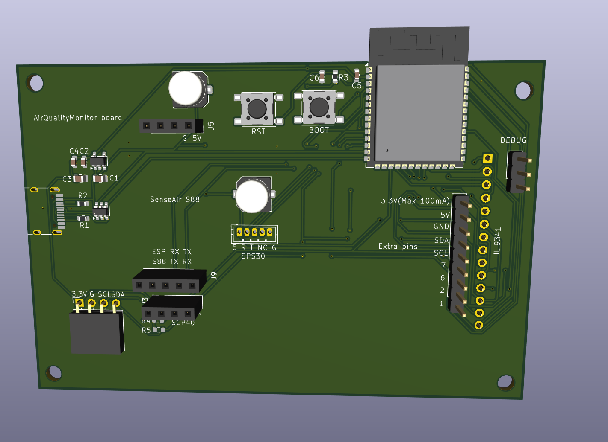
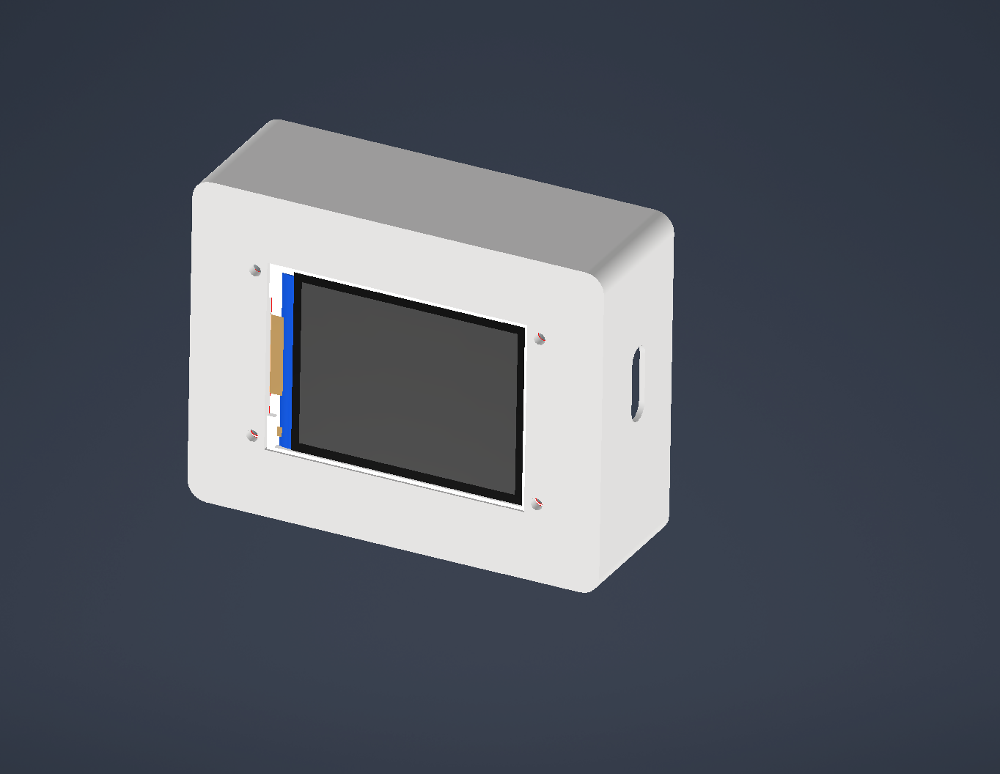
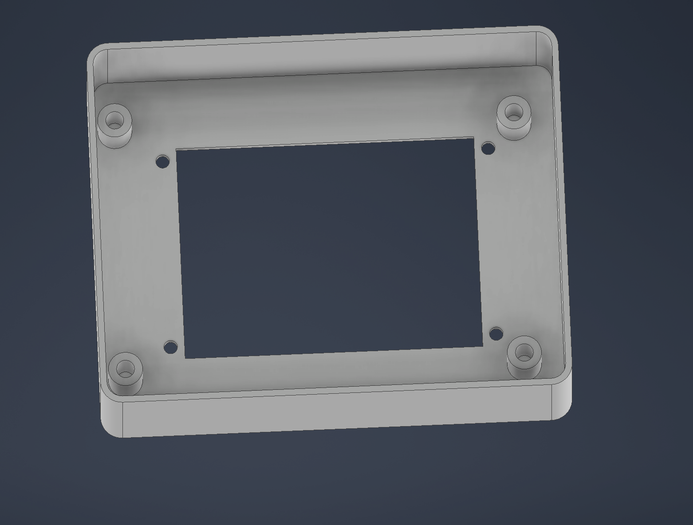

# CompactAQMonitor
A portable device designed to monitor Air Quality parameters inside a room with high accuracy and zero drift. Built around a custom PCB, powered by ESP32-S2. Sensors consists of SHT40, SGP40, SPS30, and SenseAir S88, and combined wiht ILI9341 Touchscreen LCD inside 3D printed enclosure

# Features
- True CO2 Sensing with NDIR: This devices uses a Senseair S88 Residential sensor for accurately measuring CO2 using Non-Dispersive Infrared, rather than deriving the data like CO2 Equivalent sensors
- Precise VOC, Temperature, and RH Tracking: this device uses the Sensirion SGP40 TVOC&NoX sensor (DFRobot Module) to accurately measure VOC levels inside a room, paired with the SHT40 to measure Temp & RH.
- PM Monitoring: This device uses a Sensirion SPS30 to track the Particulate Matter, because the SPS30 is contamination resistant with filter before air goes into the laser sensor
- Interactive 2.8inch TFT Display: Uses the ILI9341 with XPT2046 Touch display for interactive viewing
- Modular Hardware: Nothing is soldered on, just using female headers to solder the components, there is also expandable IO to add more sensors (using unpopulated GPIO pins)
# Background
I am living in a high-density dorm room with closed windows, which causes indoor air quality to plummet rapidly (especially CO2). High CO2 levels can lead to sleep disruption which causes fatigue and brain fog. Cheap sensors usually fake the CO2 data using derived values to estimate CO2 which is prone to fail and be innacurate.
CompactAQMonitor is designed as an accurate and reliable sensor & desk companion without spending too much money as a real air quality monitor, but still get the core features.

# Images

